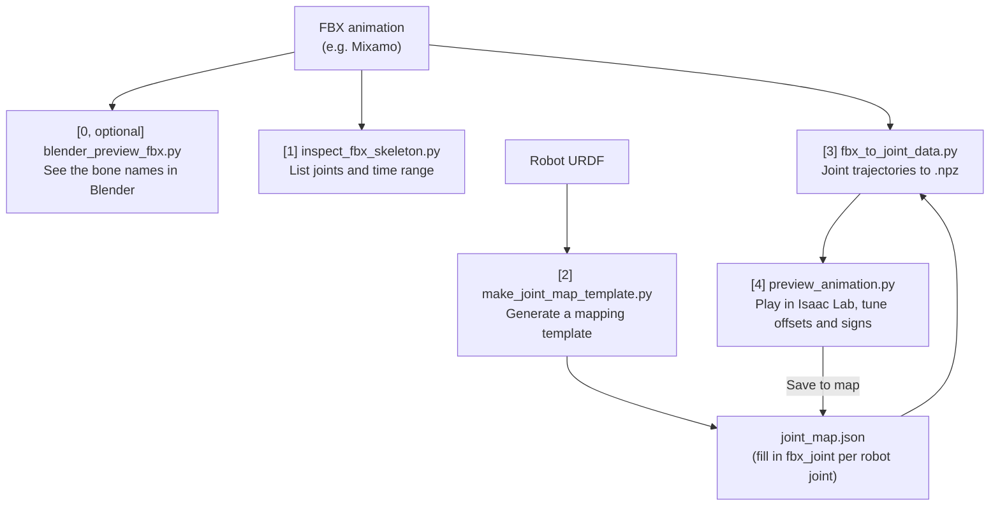

# Robot Motion Reference

**Reference motions for legged-robot imitation learning, from two sources: a procedural gait generator you tune in the browser, and a retargeting pipeline that turns motion-capture animations into robot joint trajectories.**

<p align="center">
  
</p>

<p align="center">
  <em>Gait Studio: drive the robot with a velocity command, tune the style, and check it against the servos.</em>
</p>

| Tool | What it does | Needs |
|---|---|---|
| [**Gait Studio**](gait_studio/) | Procedural, command-conditioned gait generator with a live browser UI. Bakes a **gait table**: one gait cycle for every (vx, vy, yaw rate) command. | Python, MuJoCo, and a robot model (the BipedRobot files, or your own). No Isaac Lab, no GPU. |
| [**FBX retargeting**](#fbx-retargeting-pipeline) | Extracts joint angles from an FBX animation (for example from [Mixamo](https://www.mixamo.com)) and maps them onto your robot's joints. | [Isaac Lab](https://isaac-sim.github.io/IsaacLab/) for most steps. |

Gait Studio is the main tool. The FBX pipeline is the older one, still useful for non-walking motions and for
showing a human clip next to the generated gait as a style reference.

---

## Gait Studio

Inspired by Disney Research's *Interactive Design of Stylized Walking Gaits for Robotic Characters*
(SIGGRAPH 2024). You describe a walking style with a few dozen knobs (cadence, step height, stance width,
sway, heel-to-toe, ...). Gait Studio turns it into footsteps, a balanced centre-of-mass motion and whole-body
inverse kinematics, for any command. It then grades the result against the servo model: joint limits, speed,
torque, balance.

Features:

- **Command-conditioned.** Drive any forward, sideways and turning velocity, and the gait regenerates in
  a fraction of a second.
- **Human-like timing.** The cycle length follows the command the way a human's cadence follows speed.
- **Heel-to-toe feet** derived from leg geometry, not hand-set angles.
- **Feasibility checks** against a servo model, with an open-loop physics preview.
- **Left/right symmetric tables** ready for mirror augmentation.

```bash
git clone --recurse-submodules https://github.com/AsterisCrack/BipedRobot   # robot model + servo data
cd BipedRobot/robot_motion_reference
pip install -r gait_studio/requirements.txt

python -m gait_studio.app                                  # design at http://localhost:8080
python -m gait_studio.bake --style gait_studio/styles/default.yaml --out processed/gait_table.npz
```

The bundled robot config points at the [BipedRobot](https://github.com/AsterisCrack/BipedRobot) model files,
which is why the clone above starts there. To use your own robot, see
[Robot config](gait_studio/README.md#robot-config) in the Gait Studio guide, which also covers the knobs, the
table format and how a training environment reads it.

---

## FBX retargeting pipeline

Built around the Mixamo to Isaac Lab workflow, but it works with any FBX skeleton and any robot URDF.



Steps 3, 4 and "edit the map" repeat until the animation looks right on your robot.

### Requirements

| Script | Needs |
|---|---|
| `make_joint_map_template.py` | Python standard library only |
| `inspect_fbx_skeleton.py`, `fbx_to_joint_data.py`, `preview_animation.py` | [Isaac Lab](https://isaac-sim.github.io/IsaacLab/main/source/setup/installation/index.html) (bundles Isaac Sim, PyTorch and Pixar USD). `preview_animation.py` also needs `tkinter` (`sudo apt install python3-tk` on Debian/Ubuntu). |
| `blender_preview_fbx.py` | [Blender](https://www.blender.org/download/) 3.6+, which runs it with its own Python |

Run the Isaac Lab scripts with Isaac Lab's Python, after `pip install -r requirements.txt`.
FBX conversion needs an NVIDIA GPU, even with `--headless`.

### 0. Look at the skeleton in Blender (optional)

Do this first if you don't know the skeleton. It plays the animation and labels every joint in the viewport.

```bash
blender --python src/blender_preview_fbx.py -- --fbx path/to/animation.fbx
```

| Flag | Default | |
|---|---|---|
| `--fbx` | required | FBX file |
| `--scale` | `1.0` | Uniform import scale (for example `0.01`) |
| `--fps` | scene's | Override the scene FPS |

### 1. List the FBX joints

```bash
python src/inspect_fbx_skeleton.py --fbx path/to/animation.fbx --headless
```

Prints every joint path and the animation time range. You will copy joint paths from this output into the
map. Takes `--fbx` or `--usd`, plus `--usd-out` and `--force` (see step 3).

> If Isaac Lab's FBX converter fails, convert the file by hand: open it in Isaac Sim (**File, Import**), save
> it as `.usd` (**File, Save As**), and pass `--usd` instead of `--fbx` in every command.

### 2. Create a joint map

```bash
python src/make_joint_map_template.py --urdf path/to/Robot.urdf --out processed/my_robot_map.json
```

Writes one entry per revolute joint of the URDF. Fill in `fbx_joint` for each one. A complete Mixamo to
12-joint biped example is in [`processed/joint_map_template.json`](processed/joint_map_template.json).

```json
{
  "robot_joint": "r_hip_y",
  "fbx_joint": "mixamorig_Hips/mixamorig_RightUpLeg",
  "euler_component": "x",
  "euler_order": "XYZ",
  "sign": -1.0,
  "offset_deg": 0.0,
  "scale": 1.0
}
```

| Field | |
|---|---|
| `robot_joint` | Joint name in the URDF |
| `fbx_joint` | Slash-separated bone path from step 1 |
| `euler_component` | `"x"`, `"y"` or `"z"`: which Euler angle of the bone to use. Recommended for Mixamo. |
| `euler_order` | Only `"XYZ"` is supported |
| `axis` | Rotation axis, used when `euler_component` is absent (the template fills it in from the URDF) |
| `scale`, `offset_deg`, `sign` | Applied in this order: `angle * scale + offset`, then times `sign` |

`offset` (radians) is also accepted and is added to `offset_deg`. The preview tool's **Save to map** writes
`offset_deg` and removes `offset`.

### 3. Extract joint trajectories

```bash
python src/fbx_to_joint_data.py \
    --fbx path/to/animation.fbx --joint-map processed/my_robot_map.json \
    --out processed/animation.npz --headless
```

| Flag | |
|---|---|
| `--fbx` / `--usd` | The animation: an FBX (converted on the fly) or a ready USD |
| `--joint-map` | Map from step 2 (required) |
| `--out` | Output `.npz` (required) |
| `--fps N` | Resample to N frames per second |
| `--usd-out path` | Where to save the converted USD |
| `--force` | Redo the FBX conversion even if a USD exists |

Output:

```python
data = np.load("processed/animation.npz", allow_pickle=True)
data["joint_names"]  # (J,)           joint names
data["positions"]    # (T, J) float32 joint angles [rad]
data["velocities"]   # (T, J) float32 joint velocities [rad/s]
data["fps"], data["dt"]               # frame rate and time step
data["source_usd"], data["source_fbx"]
```

### 4. Preview and tune

Tell the previewer where your robot's USD is, once:

```bash
cp config.example.yaml config.yaml      # then set robot_usd (config.yaml is gitignored)
```

```bash
python src/preview_animation.py --npz processed/animation.npz \
    --joint-map processed/my_robot_map.json --play --loop
```

| Flag | |
|---|---|
| `--npz` | Output of step 3 (required) |
| `--joint-map` | Loads `offset_deg` and `sign` into the panel and enables saving them back |
| `--robot-usd` | Robot USD, overriding `config.yaml` |
| `--play`, `--loop`, `--speed` | Autoplay, loop, playback speed multiplier |
| `--no-freeze-base` | Let the robot fall freely, to check that foot contact looks natural |

The panel has a playback FPS slider, a per-joint offset slider (plus or minus 180 degrees), a **Flip** checkbox
per joint and a **Save to map** button. Save, then re-run step 3 to regenerate the `.npz` with the new values.

---

## Repository layout

```
robot-motion-reference/
├── gait_studio/            Gait Studio: generator, UI, baker, tests (see its README)
├── src/                    FBX pipeline scripts (steps 0 to 4)
├── processed/              Example outputs: joint map template, gait table style and report
├── config.example.yaml     Copy to config.yaml and set robot_usd
└── requirements.txt        Dependency notes for the FBX scripts
```

Generated `.npz`, `.fbx` and `.usd` files are gitignored.

---

## Acknowledgements

Gait Studio is inspired by Disney Research's *Interactive Design of Stylized Walking Gaits for Robotic
Characters* (SIGGRAPH 2024). It was built for the
[BipedRobot](https://github.com/AsterisCrack/BipedRobot) project, which trains policies to imitate its tables.

## License

[MIT](LICENSE)
